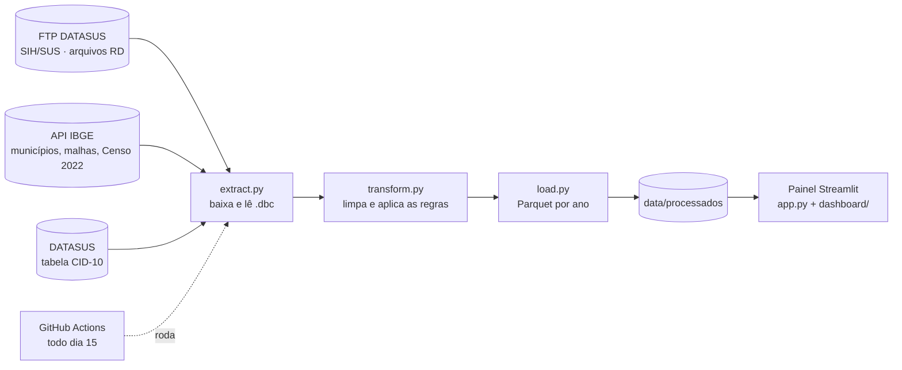

# SUS Sul Analytics

### Internações hospitalares do SUS no Paraná, Santa Catarina e Rio Grande do Sul

[](https://github.com/AdryanSilva1/sus-hospital-analytics/actions/workflows/testes.yml)
[](https://github.com/AdryanSilva1/sus-hospital-analytics/actions/workflows/atualizar-dados.yml)


Pipeline de dados + painel interativo com **dados oficiais do DATASUS e do IBGE**.
O pipeline baixa os arquivos direto do FTP do Ministério da Saúde, limpa, resume e salva em
Parquet. O painel só lê o resultado. Todo mês o GitHub Actions roda tudo de novo e os dados
se atualizam sozinhos, sem nenhum download manual.

<!-- Depois do deploy: link do painel ao vivo e um GIF em docs/painel.gif -->

> 🇬🇧 [English summary below](#english-summary)

---

## O que dá para descobrir no painel

- Quantas pessoas foram internadas, quantas morreram no hospital e quanto o SUS pagou
- Como isso mudou **mês a mês** e em comparação com o ano anterior (mesmos meses)
- Quais doenças e sistemas do corpo mais internam e quais custam mais por internação
- Quais cidades têm mais internações **por 100 mil habitantes**, contando onde o paciente mora
- Como cada **região do IBGE** se compara (em SC: Florianópolis, Joinville, Blumenau, Chapecó, Criciúma, Lages e Caçador)
- Quais cidades funcionam como **polo regional**, recebendo pacientes de outras cidades,
  e de onde vêm os pacientes de cada uma
- Diferenças por faixa etária, sexo e raça/cor

Quase tudo é clicável, como num Power BI: clicar numa barra, bolha do mapa ou linha de tabela
filtra o painel inteiro. Clicar de novo, ou no ✕ do filtro, desmarca.

| Página | O que mostra |
|---|---|
| **Painel** | No estilo Power BI: número principal com variação contra o ano anterior, botões dos sistemas do corpo, barras por região do IBGE e por município, mapa com ruas, tabela de diagnósticos (CID-10), filtros de faixa etária, raça/cor, sexo e procedimento, sete medidas e tabela por sistema |
| **Gastos e evolução** | Valor pago mês a mês × ano anterior, por ano, estado, sistema, procedimento e município; doenças mais caras por internação |
| **Fluxo de pacientes** | Onde o paciente mora × onde foi internado, taxa por 100 mil hab. e polos regionais |

---

## Como funciona



O pipeline gera cinco tabelas resumidas por ano e estado, cada uma com o corte que o
painel precisa:

| Tabela | Corte | Usada em |
|---|---|---|
| `por_municipio` | município do hospital × sistema × procedimento | mapa, regiões, municípios, número principal |
| `por_mes` | mês × sistema × procedimento | evolução mensal e comparação com o ano anterior |
| `por_cid` | doença (CID-10) × procedimento | tabela de diagnósticos e doenças mais caras |
| `por_perfil` | sistema × procedimento × sexo × faixa etária × raça/cor | filtros de faixa etária, raça/cor e sexo |
| `por_fluxo` | município onde mora × município do hospital | página Fluxo e taxa por 100 mil hab. |

Resumir antes deixa o painel leve: ele nunca lê os milhões de linhas brutas.
Quando sai um mês novo no DATASUS, o ano daquele mês é refeito inteiro, para pegar também as
correções que o DATASUS faz em meses anteriores.

---

## Regras de contagem

| Indicador | Como é calculado |
|---|---|
| Internação | AIH principal aprovada (`IDENT = 1`). AIHs de continuação ficam de fora para não contar duas vezes |
| Cirurgia | Procedimento principal do grupo 04 da tabela SIGTAP (clínico = grupo 03) |
| Óbito hospitalar | `MORTE = 1` (morreu durante a internação) |
| Valor pago | `VAL_TOT` da AIH, valor nominal sem correção pela inflação |
| Município | Onde fica o hospital (`MUNIC_MOV`). Na página Fluxo, também onde o paciente mora (`MUNIC_RES`) |
| Região | Região geográfica intermediária do IBGE do município do hospital |
| Taxa por 100 mil hab. | Internações dos moradores ÷ população do Censo 2022 × 100.000 (cidades com 5 mil hab. ou mais) |
| Comparação com o ano anterior | Mesmos meses nos dois anos (ex.: jan–ago/2025 × jan–ago/2024) |

## Limitações

- **Fila de espera, mortes na fila e reinternações** não estão no painel: as bases públicas não identificam o paciente nem a fila.
- A API do IBGE não responde fora do Brasil. Por isso municípios, regiões, mapa e população são baixados uma vez num computador no Brasil e ficam salvos no repositório; o GitHub Actions só atualiza os dados do DATASUS.
- Só entram internações pagas pelo SUS (rede pública e conveniada).
- O DATASUS publica com alguns meses de atraso e pode corrigir meses recentes.
- Município, doença e perfil do paciente estão em tabelas separadas (juntas ficariam grandes demais),
  então dá para filtrar por um desses de cada vez. Quando um visual não consegue aplicar um filtro, ele avisa.
- Em médias e porcentagens, itens com menos de 50 internações ficam fora dos rankings.
- A taxa por 100 mil usa a população do Censo 2022 para todos os anos.

---

## Como rodar

```bash
git clone https://github.com/AdryanSilva1/sus-hospital-analytics.git
cd sus-hospital-analytics

python -m venv .venv
source .venv/bin/activate          # Windows (PowerShell): .venv\Scripts\activate

pip install -r requirements-pipeline.txt
```

**1. Buscar os dados** (a primeira carga demora: são centenas de arquivos)

```bash
python -m pipeline.run --uf SC --ano-inicial 2025   # teste rápido
python -m pipeline.run                              # tudo: PR, SC e RS desde 2019
```

**2. Abrir o painel**

```bash
python -m streamlit run app.py
```

**3. Testes e estilo**

```bash
pytest -q        # pipeline, regras do painel e o painel aberto com dados falsos
ruff check .
```

Os testes não acessam a internet: as APIs são simuladas e o painel é testado com
`tests/dados_falsos.py`, que gera uma pasta de dados pequena e falsa.

---

## Estrutura

```
sus-hospital-analytics/
├── app.py                      ← monta a página (topo + páginas)
├── pipeline/
│   ├── config.py               ← estados, ano inicial, endereços das fontes
│   ├── extract.py              ← FTP do DATASUS, CID-10, APIs do IBGE
│   ├── transform.py            ← limpeza e regras de contagem
│   ├── load.py                 ← salva em Parquet, um ano por vez
│   └── run.py                  ← executa tudo em ordem
├── dashboard/
│   ├── dados.py                ← leitura das tabelas e recorte pelos filtros
│   ├── medidas.py              ← internações, óbitos, valor... e formatação (R$, %)
│   ├── filtros.py              ← estado dos filtros e o que cada clique faz
│   ├── painel.py               ← o contexto que todas as páginas recebem
│   ├── topo.py                 ← cabeçalho, sistemas do corpo e filtros ativos
│   ├── componentes.py          ← blocos, cartões, gráficos e tabelas clicáveis
│   ├── visuais.py              ← figuras Plotly (barras, linha, mapa)
│   ├── icones.py               ← ícone de cada sistema do corpo e de cada medida
│   ├── paginas/                ← uma página por arquivo
│   └── styles.css
├── tests/
├── data/
│   ├── brutos/                 ← .dbc baixados (fora do Git)
│   └── processados/            ← Parquet usado pelo painel
└── .github/workflows/
    ├── testes.yml              ← ruff + pytest a cada push
    └── atualizar-dados.yml     ← pipeline todo dia 15
```

---

## Tecnologias

**Python** · **Pandas** · **pyreaddbc + dbfread** (arquivos `.dbc` do DATASUS) · **Parquet** ·
**Streamlit + Plotly** · **GitHub Actions** · **pytest** · **ruff**

## Fontes

- [SIH/SUS — DATASUS](https://datasus.saude.gov.br/) · FTP `ftp.datasus.gov.br/dissemin/publicos/SIHSUS/200801_/Dados`
- [IBGE — APIs de Localidades, Malhas e Agregados](https://servicodados.ibge.gov.br/api/docs) (nomes, contornos e população do Censo 2022, agregado 4709)
- [Tabela CID-10 — DATASUS](http://www2.datasus.gov.br/cid10/V2008/cid10.htm)
- [Tabela SIGTAP](http://sigtap.datasus.gov.br/)

---

## English summary

**SUS Sul Analytics** is an end-to-end data project on public hospital admissions (SUS) in
Southern Brazil (Paraná, Santa Catarina and Rio Grande do Sul).

- **Pipeline (ETL):** downloads the official DATASUS hospital records straight from the Ministry
  of Health FTP, cleans and aggregates them into five Parquet tables, and enriches them with
  IBGE data (municipality names and borders, 2022 Census population). A GitHub Actions job
  refreshes everything monthly, with no manual steps.
- **Dashboard (Streamlit + Plotly):** Power BI-style cross-filtering (click any bar, map bubble
  or table row to filter the whole page), month-over-month trends vs. the previous year,
  spending, an interactive map, admissions per 100k inhabitants, and patient flow between
  cities (where patients live vs. where they are treated).
- **Engineering:** modular code (one file per page), tests for the pipeline, dashboard rules and
  a headless run of the full app with fake data, linting with ruff and CI on every push.

---

## Autor

**Adryan Silva Santos** · Dados & Automação · Saúde

🔗 [LinkedIn](https://www.linkedin.com/in/adryan-silva-santos) · [GitHub](https://github.com/AdryanSilva1)

Licença [MIT](LICENSE).
